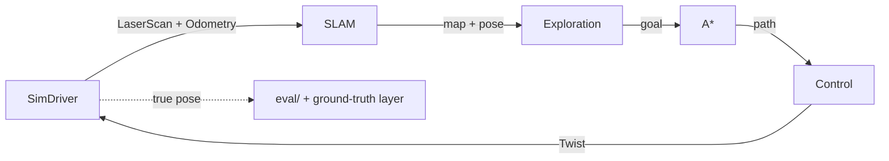

# lidar-explorer

A simulated robot explores an unknown maze with a 2D lidar and **noisy odometry**, localizing itself and building the map at the same time (SLAM). Everything runs in the browser: no install, no server.

> **Status: planned.** Nothing runs yet. Phase F0 (repo, Angular app, CI, Vercel) is next.

## What it will do

- Open the link and it starts on its own: a seeded random maze, explored until no reachable frontier is left, then back to the start.
- Show two views side by side: the real world and what the robot *believes* (map, particles, pose, frontiers, path).
- Plot the position error of pure odometry against the SLAM estimate, live.
- Be reproducible: the same seed gives the same run (`?seed=42`).

## How it works



- **Localization:** particle filter (Monte Carlo localization) with an odometry motion model, a likelihood field and low-variance resampling.
- **Mapping:** log-odds occupancy grid updated with Bresenham ray tracing, using the *estimated* pose.
- **Planning:** obstacle inflation, A* over 8 neighbours, pure pursuit.
- **Exploration:** frontier detection and clustering, nearest-by-path-cost goal selection, blacklist for unreachable frontiers.
- **Anti-cheat:** the SLAM, localization, mapping, planning and exploration modules cannot import the simulator. This is enforced by a lint rule and a CI test, so the map can never be built from the true pose.

The simulator speaks ROS 2-shaped messages (`LaserScan`, `Odometry`, `OccupancyGrid`, `Twist`), so the hardware sits behind a `RobotDriver` interface: today a simulator, later a real robot.

## Results

Coming with the benchmark phase: coverage, absolute trajectory error (SLAM vs odometry), map quality, collisions and per-step cost over 30 seeded runs.

## Limitations (v1)

- No loop closure and no per-particle maps, so long, repetitive corridors can drift.
- No global localization or kidnapped-robot recovery.
- Simulated sensors only; the noise model is Gaussian and will not capture every real-world failure.

## Repository layout

```
src/core/    pure TypeScript core (no Angular, no DOM): sim, mapping, localization, slam, planning, exploration, eval
src/app/     Angular UI
src/worker/  Web Worker wrapper
bench/       headless Node benchmark
supabase/    SQL migrations for benchmark history
```

## Development

Commands will be documented once phase F0 lands.

## AI disclosure

Most of the code is written with [Claude Code](https://claude.com/claude-code); commits carry the co-author trailer. The design, decisions and testing are the author's.

## License

[MIT](LICENSE)
