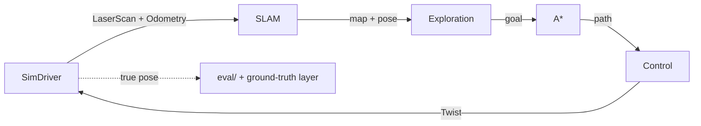

# lidar-explorer

A simulated robot explores an unknown maze with a 2D lidar and **noisy odometry**, localizing itself and building the map at the same time (SLAM). Everything runs in the browser: no install, no server.

> **Status: F0 · foundations.** The app shell, the guardrails and CI are in place; the robot arrives in F1.

## What it will do

- Open the link and it starts on its own: a seeded random maze, explored until no reachable frontier is left, then back to the start.
- Show two views side by side: the real world and what the robot *believes* (map, particles, pose, frontiers, path).
- Plot the position error of pure odometry against the SLAM estimate, live.
- Be reproducible: the same seed gives the same run (`?seed=42`).

## How it works



- **Localization:** particle filter (Monte Carlo localization) with an odometry motion model, a likelihood field and low-variance resampling.
- **Mapping:** log-odds occupancy grid updated with Bresenham ray tracing, using the *estimated* pose.
- **Planning:** obstacle inflation, A* over 8 neighbours, pure pursuit.
- **Exploration:** frontier detection and clustering, nearest-by-path-cost goal selection, blacklist for unreachable frontiers.
- **Anti-cheat:** the robot's modules (mapping, localization, SLAM, planning, control, exploration and autonomy) cannot import the simulator, the true maze or the evaluation code. An ESLint rule and an architecture test enforce it, so the map can never be built from the true pose.

The simulator speaks ROS 2-shaped messages (`LaserScan`, `Odometry`, `OccupancyGrid`, `Twist`), so the hardware sits behind a `RobotDriver` interface: today a simulator, later a real robot.

## How it's built

- **Method.** Each phase follows the same cycle: a design, a plan whose tasks carry their failing tests, test-driven tasks (each test is seen failing before the code exists), a final review, and a pull request. The author approves the design and the plan, and checks every task before the next one starts.
- **Architecture.** A hexagonal core in pure TypeScript, split into modules whose allowed dependencies live in one matrix, [`architecture/modules.mjs`](architecture/modules.mjs). The anti-cheat rule is enforced twice: by an ESLint rule, and by an architecture test that resolves every import with the TypeScript compiler API.
- **Guardrails.** Strict TypeScript; a core that compiles without DOM or Node types; ESLint limits on function size, parameters and complexity; a 90 % coverage gate on the core; and CI that runs all of it on every pull request.

The details are in [docs/architecture.md](docs/architecture.md) and [docs/conventions.md](docs/conventions.md).

## Results

Coming with the benchmark phase: coverage, absolute trajectory error (SLAM vs odometry), map quality, collisions and per-step cost over 30 seeded runs.

## Limitations (v1)

- No loop closure and no per-particle maps, so long, repetitive corridors can drift.
- No global localization or kidnapped-robot recovery.
- Simulated sensors only; the noise model is Gaussian and will not capture every real-world failure.

## Repository layout

```
src/core/      pure TypeScript core (no Angular, no DOM): math, msgs, driver, world, sim, mapping,
               localization, slam, planning, control, exploration, autonomy, eval, run
src/app/       Angular UI
src/worker/    Web Worker wrapper
architecture/  the dependency matrix, the ESLint boundaries and the architecture test
bench/         headless Node benchmark
docs/          architecture, conventions, and each phase's design and plan
supabase/      SQL migrations for benchmark history
```

## Development

Requires Node 26 (see `.nvmrc`).

```bash
npm install
npm start           # dev server on http://localhost:4200
npm test            # core tests, then app tests
npm run verify      # format check, type check, lint, tests and build: what CI runs
```

The full command list is in [CLAUDE.md](CLAUDE.md#commands).

## AI disclosure

Most of the code is written with [Claude Code](https://claude.com/claude-code); commits carry the co-author trailer. The design, decisions and testing are the author's.

## License

[MIT](LICENSE)
