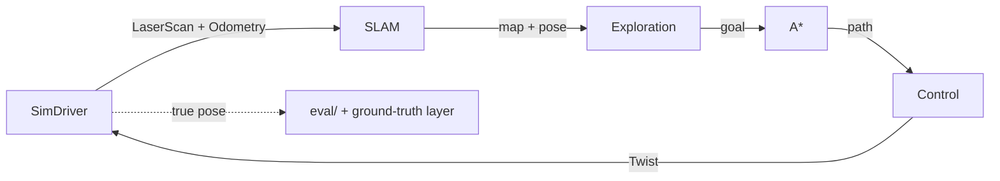

# Architecture

## Purpose

lidar-explorer simulates a differential-drive robot that explores an unknown maze with a 2D lidar and noisy odometry, and builds the map while it localizes itself (SLAM). Everything runs in the browser. This document describes how the code is organized and which mechanical guards keep that organization honest. The decisions behind it are recorded in the [F0 design](superpowers/specs/2026-11-13-f0-foundations-design.md).

## Data flow

The robot side (SLAM, exploration, planning and control) sees only what a real robot would: lidar scans and odometry. The true pose flows only to the evaluation code and to the ground-truth layer of the UI.

## Modules

The core lives in `src/core/`, in pure TypeScript: no Angular, no DOM and no Node APIs, so it runs unchanged in the browser, in a Web Worker and in Node. Each folder is a module, and other code reaches a module only through its `index.ts`.

| Module | Responsibility | May import |
|---|---|---|
| `math` | Seeded RNG, angles and `Pose2D` | — |
| `msgs` | ROS 2-shaped messages: `LaserScan`, `Odometry`, `OccupancyGrid`, `Twist`, `PoseArray` and `Path` | math |
| `driver` | Ports only: `LaserScanSource`, `OdometrySource` and `VelocityCommandSink`, which together form `RobotDriver`, plus their contract suite | msgs |
| `world` | Seeded maze generator and hand-made maps | math |
| `sim` | Differential robot, lidar raycasting, noisy odometry, collisions, and `SimDriver` | math, msgs, world, driver |
| `mapping` | Log-odds occupancy grid and ray tracing | math, msgs |
| `localization` | Particle filter (Monte Carlo localization) | math, msgs, mapping |
| `slam` | Ties mapping and localization together | math, msgs, mapping, localization |
| `planning` | Obstacle inflation and A* | math, msgs, mapping |
| `control` | Pure pursuit and the safety stop | math, msgs |
| `exploration` | Frontiers, goal selection and the unreachable blacklist | math, msgs, mapping, planning |
| `autonomy` | The behaviours and their state machine: go to a point, explore, return home | math, msgs, driver, slam, planning, control, exploration |
| `eval` | Metrics against the ground truth | math, msgs, world, mapping |
| `run` | The composition root: wires world, simulator, autonomy and evaluation together | all of the above |

The table mirrors [`architecture/modules.mjs`](../architecture/modules.mjs), which is the source of truth: the ESLint boundaries and the architecture test are both generated from it, and the architecture test fails when the folders in `src/core/` and the matrix diverge.

Outside the core, `src/app/`, `src/worker/` and `bench/` import only `run` and the `msgs` types.

## The anti-cheat rule

The project's founding condition is that the robot localizes with noisy odometry. A map built from the simulator's true pose would be mapping, not SLAM. So the autonomy modules (`mapping`, `localization`, `slam`, `planning`, `control`, `exploration` and `autonomy`) never import `sim`, `world`, `eval` or `run`: they can see neither the true pose nor the true maze.

Two independent guards enforce the rule, and both are generated from the matrix:

- an ESLint `no-restricted-imports` rule, which flags the import in the editor;
- the architecture test, which resolves every import path with the TypeScript compiler API, including type-only imports, re-exports and dynamic `import()`.

## Seams

Interfaces exist only at real seams, where a second implementation is certain:

| Seam | Lives in | Arrives in | Implementations |
|---|---|---|---|
| `LaserScanSource`, `OdometrySource`, `VelocityCommandSink` (together `RobotDriver`) | `core/driver` | F1 | `SimDriver` in `core/sim`; a real robot later. Every driver passes the same contract suite. |
| `Rng` with `fork(name)` | `core/math` | F1 | A seeded generator; each subsystem forks its own stream, so one extra draw in one subsystem does not shift another. |
| `GroundTruthSource` | `core/eval` | With the first metrics against the truth (F2–F3) | The simulator's true pose and map. Only `eval` and `run` receive it. |
| `SimulationPort` (an `InjectionToken`) | `app/core` | F1 | A main-thread adapter in F1–F7 and a Web Worker adapter in F8. |
| `BenchResultsRepository` | Benchmark code | F7 | Supabase, and a local JSON file. |

Any other abstraction, such as a resampler or a sensor model, gets an interface only when its second implementation appears.

## The tick loop

The simulation advances in fixed steps of `dt`. Each tick:

1. `sim.step(twist)` moves the robot and produces a `LaserScan` and an `Odometry`.
2. `autonomy.tick()` runs SLAM, the current behaviour, the planner and the controller, and returns the next `Twist`.
3. `eval` compares the truth with what the robot believes.
4. `run.snapshot()` returns plain data and typed arrays for the UI and the worker.

The core has no wall clock: time advances only by `dt`, and the UI decides how many ticks to run per frame.

## The Angular app

Angular 22, with standalone components, zoneless change detection, signals, OnPush (the default in Angular 22) and `inject()`. The folders arrive with the phases that need them:

- `src/app/core/`: `SimulationPort` and its adapters, on the main thread in F1–F7 and in a Web Worker in F8.
- `src/app/features/explorer/`: the page, the controls, the metrics, and `render/`, with pure `drawX(ctx, snapshot, viewport)` functions. The canvas y-flip happens there and nowhere else.
- `src/app/features/results/`: the benchmark results panel (F7).

Components are thin: they render snapshots and forward user input, and they carry no robotics logic.

## Guardrails

Every guard runs in `npm run verify`, which CI runs on every pull request.

| Guard | What it catches | Where it lives |
|---|---|---|
| Core TypeScript project | DOM or Node APIs in the core (`document`, `process`, timers): they do not compile | `tsconfig.core.json`: the ES2022 library only, `types: []` |
| Core ESLint block | `Math.random`, `Date`, `performance`, `console`, timers, and browser or Node globals. Inline `eslint-disable` comments have no effect there. | The `src/core/**` block in `eslint.config.js` |
| Clean-code limits | Functions over 40 lines, more than 4 parameters, complexity over 10, boolean flag parameters, files over 300 lines, `I`-prefixed interfaces, `@ts-ignore` | `eslint.config.js` |
| Boundaries | Imports the matrix forbids, deep imports past a module's `index.ts`, and app code that reaches an internal module | `architecture/eslint-boundaries.mjs`, loaded by ESLint |
| Architecture test | The same rules on resolved paths, plus folders missing from the matrix, packages imported by the core, and import cycles | `architecture/architecture.spec.ts` |
| Coverage gate | Core code under 90 % of lines, branches, functions or statements | `vitest.core.config.ts` |
| CI | Any failure above, on every pull request; `main` accepts only pull requests with a green check | `.github/workflows/ci.yml` and the ruleset on `main` |
| Permissions | Claude editing a guardrail file without asking, force pushes, and reading `.env` files | `.claude/settings.json` |

## Adding a module

1. Create `src/core/<name>/` with an `index.ts`, and give every export TSDoc.
2. Add `<name>` to `CORE_MODULES` in `architecture/modules.mjs`, with the modules it may import. If the robot runs it, add it to `AUTONOMY_MODULES` as well, so the anti-cheat rule covers it.
3. Write its tests first, next to the code.

Skipping a step fails loudly:

- A folder with no matrix entry, or a matrix entry with no folder, fails the architecture test "lists exactly the folders in src/core". Imports into an unlisted folder fail as `unknown-module`.
- Importing a file other than another module's `index.ts` fails as `index-only` in the test and as a deep import in ESLint.
- A module without tests fails the coverage gate.

Until a module has code, a `.gitkeep` keeps its folder in git, so the matrix and the folders stay in step.
